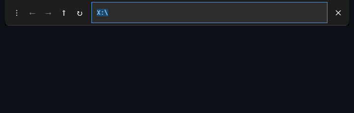

# DesktopLS

[](https://github.com/markmysler/desktop-ls/actions/workflows/ci.yml)
[](https://github.com/markmysler/desktop-ls/releases/latest)
[](LICENSE)

A lightweight navigation bar for the Windows desktop. Point your desktop at any folder on disk, then browse, go back and forward, and switch between folders like a file manager, while each folder keeps its own icon arrangement.



## Features

- **Show any folder on the desktop**: type a path (with autocomplete) and press Enter; the desktop shows that folder's contents
- **Back / Forward / Up** with history (Alt+Left, Alt+Right, Alt+Up) and **Refresh** (F5)
- **Path autocomplete**: subfolders are suggested as you type; Tab moves through the suggestions, Enter or double-click opens one
- **Icon layout memory**: icon positions are saved per folder and per monitor setup, and restored when you come back
- **First-visit grid**: a folder you've never opened gets its icons laid out in a tidy grid across all monitors
- **Auto-hide** (on by default): the bar hides while another window is maximized
- **Move the bar**: drag it anywhere; it snaps to the top or bottom edge of the monitor you drop it on and stays there next time
- **Reserve space** (optional): the bar becomes a real app bar, like the taskbar, so maximized windows stop at it instead of covering it. Windows may move desktop icons out from under the reserved strip
- **No Explorer restarts**: switching folders takes well under a second and leaves the taskbar and your open windows alone
- **Crash recovery**: your real desktop comes back on exit, on errors, at log-off, and on the next start after a crash
- **Single `.exe`**: the release build is self-contained; no .NET install needed

Network folders can't be shown (Windows junctions only reach local drives).

## What DesktopLS changes on your system

DesktopLS changes Windows settings, so here is exactly what it touches and how to undo it.

| What | Where | When it's undone |
|---|---|---|
| Your **Desktop folder location**, pointed at a junction DesktopLS owns | `HKCU\Software\Microsoft\Windows\CurrentVersion\Explorer\User Shell Folders` → `Desktop` = `%LocalAppData%\DesktopLS\DesktopView` | Stays set (see below). While DesktopLS isn't showing another folder, the junction points at your real desktop, so everything looks and works as before and files you save to the Desktop land in your real Desktop folder |
| The junction itself | `%LocalAppData%\DesktopLS\DesktopView` → your real desktop, or the folder being shown | Pointed back at your real desktop when you close DesktopLS, when it crashes or Windows logs off, or at the latest the next time it starts |
| Your real desktop path | `%LocalAppData%\DesktopLS\desktop_real.txt` | Kept while the junction is in use |
| Saved icon layouts and settings | `%LocalAppData%\DesktopLS\layouts.json`, `settings.json` | Kept; delete them to reset |
| "Run on startup" (only if you enable it) | `HKCU\Software\Microsoft\Windows\CurrentVersion\Run` → `DesktopLS` | Removed when you turn the setting off |

The first time it runs, DesktopLS points your Desktop at the junction and asks to restart Explorer once (or you can wait until you next sign in): Explorer only reads the Desktop location when it starts. After that, switching never restarts Explorer.

It never modifies the shared **Public Desktop** (`C:\Users\Public\Desktop`); its shortcuts stay visible on any folder you open. (Version 1.0.0 did move them; starting a newer version puts back anything it left behind.)

**If your desktop is ever stuck on another folder**, start DesktopLS once and close it.

**To stop using DesktopLS** (for example before uninstalling): open the ⋮ menu → **Stop using DesktopLS…**. It points your Desktop back at its real folder, turns off Run on startup, restarts Explorer once, removes the junction and closes. Uninstallers can run `DesktopLS.exe --undo-setup` for the same thing (add `--no-restart` to leave Explorer alone; the change then shows at the next sign-in). Your files and saved layouts are kept.

By hand, if DesktopLS is gone: right-click your Desktop folder in File Explorer → **Properties** → **Location**, type your real desktop path (usually `C:\Users\<you>\Desktop`) → OK, and answer **No** when asked to move the files. Sign out and back in, then remove the junction with `rmdir "%LocalAppData%\DesktopLS\DesktopView"` (plain `rmdir` removes only the junction, never what it points at).

## Installation

**Download:** get `DesktopLS.exe` from the [latest release](https://github.com/markmysler/desktop-ls/releases/latest), put it anywhere (for example `%LocalAppData%\Programs\DesktopLS`), and run it. Windows 10 or 11, x64.

To start it with Windows, open the ⋮ menu and enable **Run on startup**.

A winget package is planned but not published yet.

**Build from source** (needs the [.NET 8 SDK](https://dotnet.microsoft.com/download/dotnet/8.0)):

```
git clone https://github.com/markmysler/desktop-ls.git
cd desktop-ls
dotnet run --project src/DesktopLS/DesktopLS.csproj
```

Single-file release build: `dotnet publish src/DesktopLS/DesktopLS.csproj -c Release`, output in `src/DesktopLS/bin/Release/net8.0-windows/win-x64/publish/`.

## Usage

| Action | How |
|---|---|
| Open a folder | Type a path and press Enter (or pass it as an argument: `DesktopLS.exe "D:\Projects"`) |
| Autocomplete | Type; **Tab** moves through suggestions, **Enter** opens the selected one, **Esc** closes the list |
| Back / Forward | ← → buttons, or Alt+Left / Alt+Right |
| Up one level | ↑ button or Alt+Up |
| Refresh | ↻ button or F5 |
| Move the bar | Drag it; it snaps to the top or bottom edge of that monitor |
| Settings | ⋮ button (run on startup, hide when a window is maximized, reserve space at the screen edge, stop using DesktopLS) |
| Close and restore your desktop | ✕ button |

If a folder can't be opened (deleted, no access), the bar says so instead of changing anything.

## How it works

- **Switching the desktop:** the Desktop known folder points at an NTFS junction. A switch replaces the junction's target in place (`FSCTL_SET_REPARSE_POINT`, so the path never disappears) and sends `SHCNE_UPDATEDIR` for it; Explorer re-reads the same path and finds the new folder's contents. Changing the Desktop location itself isn't reliable: on current Windows 11 (25H2), the Explorer that Windows starts ignores every notification that the location changed and only picks it up when it restarts. A junction needs that only once.
- **Icon positions:** Explorer's desktop is a `SysListView32` control in another process. DesktopLS allocates a buffer inside Explorer (`VirtualAllocEx`), sends `LVM_GETITEMW` / `LVM_GETITEMPOSITION` / `LVM_SETITEMPOSITION32`, and reads the results back with `ReadProcessMemory`. Icons are identified by file name through the shell's `IFolderView`, since display names repeat (`report.pdf` and `report.docx` both show as "report"). With align-to-grid on, Explorer won't drop an icon on an occupied slot; it pushes it and the rest of the column down. So a restore first moves the icons that have to move to free slots no icon wants, then puts each on its saved spot. Drawing is locked (`LockWindowUpdate`) during a switch so it shows up as one change. Layouts are stored in `layouts.json`, keyed by folder and monitor configuration.
- **Auto-hide:** checks the foreground windows for a maximized one every 500 ms.
- **Bar position:** stored as an edge, a monitor and a horizontal fraction in `settings.json`, and applied in physical pixels with `SetWindowPos` (monitor rectangles come in pixels, and each monitor can have its own DPI). With space reserved, the bar registers with `SHAppBarMessage` (`ABM_NEW` / `ABM_QUERYPOS` / `ABM_SETPOS`), re-applies on `ABN_POSCHANGED`, and gives the space back (`ABM_REMOVE`) when it closes.

## Development

```
dotnet build DesktopLS.sln
dotnet test DesktopLS.sln
```

CI builds and tests every push. Pushing a `v*` tag publishes the single-file `DesktopLS.exe` to a GitHub release.

## License

[MIT](LICENSE)
